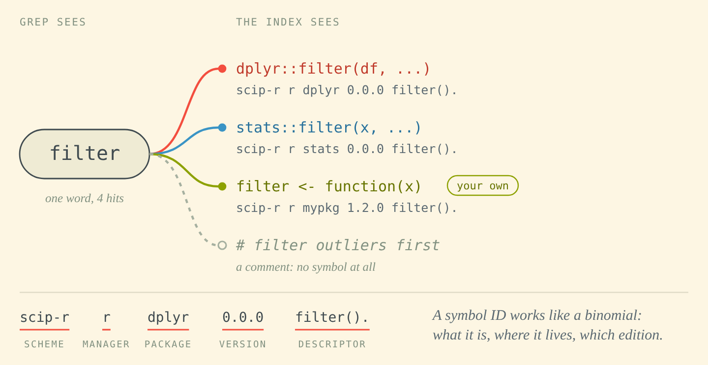
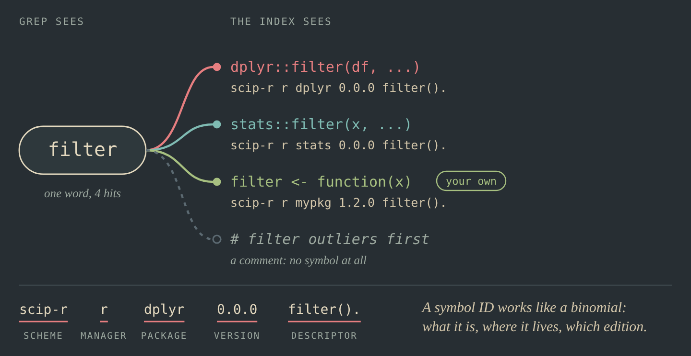
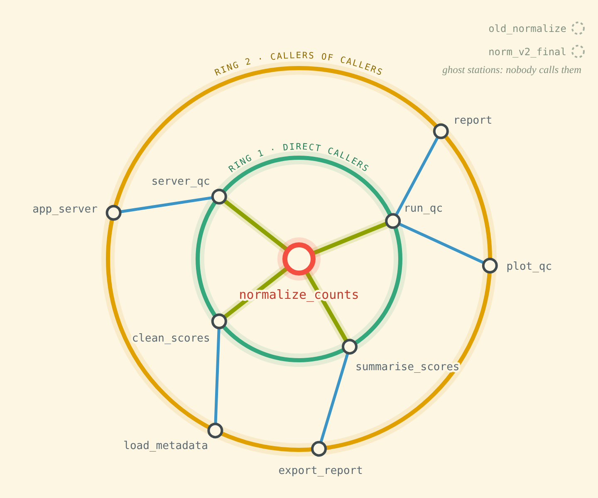
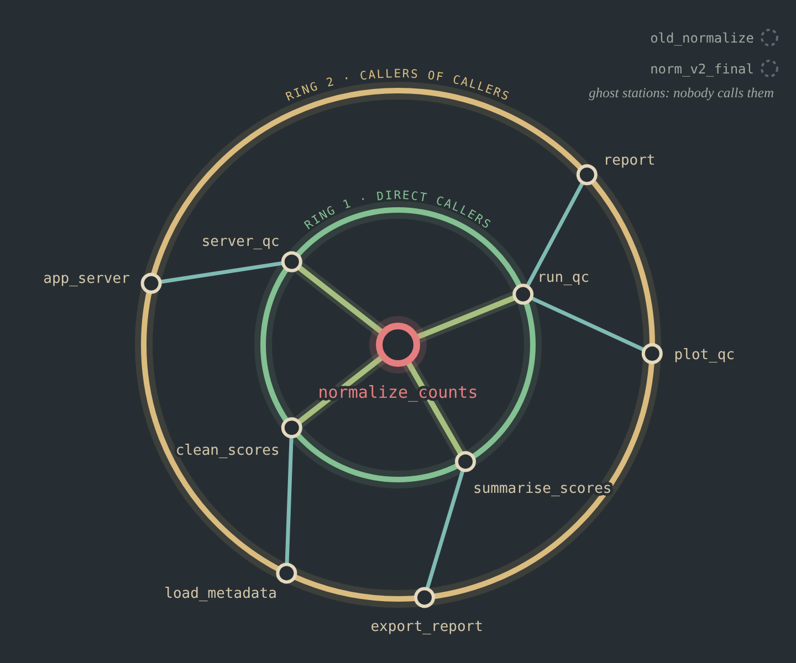

Hear me out. I’m a bioinformatician, not a compiler person, so this is a bit of a long shot, but here it is: **scip-r**. It's a simple tool to build SCIP indexes for R projects. I built is as a component of a larger project that I hope I can talk more soon, but here is the briefing:

SCIP is a language-agnostic format for indexing source code. An index is a list of documents, one per source file and in that file writes its exact position, its role (is this where the function is defined, or where it's used?), and a globally unique, human-readable symbol ID that encodes the package, the version and the path to the thing. It probably won't be of much use if you work on a small R package. Small packages are compact, and you can hold the whole thing in your head. But if you are doing any large-scale engineering in R, on a codebase of significant size, then first: I'm sorry for you, and for the many complexities that entails. And second: this might help you.





## What you get

If you do AI-driven code, you probably noted that agents spend a significant amount of time searching, mostly via grep (or ripgrep) and globs. The thing that after crossing the half-million codelines, code search becomes more challenging. Here is where SCIP joins the game.

With SCIP (and scip-r), you can get absolute precision search on where a function is defined or used. For grep, `dplyr::filter`, `stats::filter`, your own `filter`, any comments or a data-frame column are all the same. SCIP can separate  these roles.

Second, if you have all the exact locations for every funtion in an index, you now can build a call-graph. A call graph is a map: which function calls which, who depends on whom, what breaks if your agent edits some code. This means Fewer files opened, fewer tokens and more confident edits.

| Metric       | grep           | scip            | scip vs grep (95% CI) |
| ------------ | -------------- | --------------- | --------------------- |
| Files opened | 2.1 per run    | 0.7 per run     | −67% [−84%, −50%]     |
| Tokens used  | 104k per run   | 87k per run     | −17% [−28%, −6%]      |
| Right answer | 82.5% (99/120) | 96.7% (116/120) | +14% [+7%, +32%]      |

This measure came from a mini-benchmark with 5 tasks, 2 different models, 4 different repos and 3 reps ran multiple times.  

## How do I use it

Before my agent touches a single line, it goes and looks. Where’s this function defined? Who calls it? Who calls *them*? You wouldn’t do surgery without an X-ray, and you shouldn’t let an agent operate on `utils_final_v2.R` without knowing what’s wired into it. Without the index, this step is your agent wandering through grep results like a tourist without a map. With it, it’s a lookup. 

The second approach is what I call *via negativa*. This is the fun one. After a refactor, ask the agent: which code blocks are defined but called by nobody. Without an index, this is really difficult and tedious (token and time consuming). With the index, this is almost automatic. However, do not forget that R is a very special language and some of that dead code is only *pretending* to be dead: they’re exported and someone downstream uses them, or they’re being summoned through R black magic the index can’t see. (Hold that thought. We’re getting to the black magic.) So it’s a list of suspects, not convictions. 





Lastly, and this is simple a consequence of the previous two: once search is trustworthy, search doesn’t need a genius. You don’t send your senior surgeon to fetch the X-rays. So a small, cheap, fast model does the exploring and brings back a tidy list of files and functions, and the expensive model starts with a clean context and a map. The big model thinks. The little model fetches.

## The limitations

Ok, you have fast search and calligraphy... but R is cursed, though. 

R has something called *"non-standard evaluation"*, which is a nice way to say the code means whatever the function decides it means." Some examples are:

```R
# Fine. A function, called by name, like a civilised language.
normalize_counts(mat)

# Still fine. Passed around, but the name is right there.
lapply(samples, normalize_counts)

# The name is now a string. Like texting "meet me at the place".
do.call("normalize_counts", list(mat))

# Gone. The name doesn't exist until runtime. Assembled from parts, like IKEA
# furniture: nobody knows what it is until someone sits on it.
fn <- paste0("normalize_", method)
do.call(fn, list(mat))

# Non-standard evaluation. Is `count` a variable? A column? dplyr::count()?
# `filter` decides at runtime, by looking at data the index will never see.
dplyr::filter(df, count > 10)

# Attach order. This means dplyr::filter... unless something attached later
# also exports filter(). Depends on the library() calls.
library(dplyr)
filter(df, count > 10)

# The final boss. Code, in a text file, read and executed at runtime.
# Go parse that
eval(parse(text = readLines("analysis_steps.txt")))
```

So no, a static index of R will never be complete. 
Annother limitation, is that this package provides the index generation tooling, not the index querying. I hope that soon I can speak a bit more about the that soon.

## Go try it

You can get it directly from the repo, here is the [link](https://github.com/phisanti/scip-R). Point your agent towards it or in your R console go for:

```R
remotes::install_github("phisanti/scip-R")
scipR::install_scip_cli()
```

Then, to index a repo, you can do it directly from the CLI

```R
scip-r \
  --root path/to/project \
  --output index.scip \
  --include "R/**/*.R" \
  --include "inst/**/*.R" \
  --parallel 4
```

So, if you try, please tell me what you think. And if it breaks, let me know.
